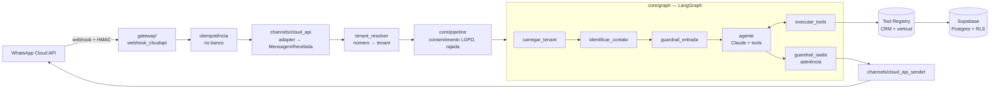

# whatsapp-agent-core

Motor **multi-tenant** de agente de atendimento por WhatsApp, feito com **LangGraph + Claude + FastAPI + Supabase**. Está em produção atendendo pacientes de uma clínica médica.

Uma única instância atende várias empresas ("tenants"). O número de WhatsApp que recebe a mensagem identifica a empresa. Cada uma tem seu prompt, sua base de conhecimento e as tools do seu segmento (vertical). O core não conhece nenhum segmento: trocar de vertical é trocar as tools registradas e o prompt.

> **Contexto:** este repositório é uma versão pública do motor usado em produção, sem dados de clientes. A integração com a agenda externa da clínica foi trocada por uma agenda de demonstração (`tools/verticals/clinica/agenda_demo.py`), e o esquema do banco foi consolidado em um arquivo só (`supabase/schema.sql`).

---

## O que tem aqui

| Área | O que o código faz |
|---|---|
| **Agente (LangGraph)** | Grafo com nós de carregar tenant → identificar contato → guardrail de entrada → agente com tools → guardrail de saída. Memória por conversa com checkpointer em Postgres; limite de iterações por turno. |
| **Multi-tenancy** | `tenant_id` em todas as tabelas; contato único por `(tenant_id, telefone)`; toda tool filtra o tenant **no código**, nunca pelo que o LLM mandou. |
| **Tool Registry** | Tools genéricas (CRM) + tools por vertical, registradas em `app/tools_setup.py` e entregues ao LLM só quando a clínica liga o recurso (agenda, transferência para humano, pedido de agendamento). |
| **Segurança de LLM** | **Guardrail de entrada determinístico** (urgência médica → SAMU 192; crise → CVV 188), sem depender do modelo. **Checagem de aderência**: número citado na resposta (preço, horário) precisa ter fonte na base, no prompt ou numa tool; se não tiver, a resposta é retida. |
| **Segurança de plataforma** | Assinatura HMAC dos webhooks da Meta; idempotência de webhook no banco; tokens do WhatsApp **cifrados com AES-256-GCM**; RLS em todas as tabelas, banco fechado para o navegador (testado no CI). |
| **LGPD** | Consentimento antes de conversar; histórico de decisões; audit log somente-inserção; telefone e dados pessoais mascarados nos logs. |
| **Custo de tokens** | Prompt caching da Anthropic (instruções + tools cacheadas, histórico fora do cache); janela de histórico; modelo por clínica (Sonnet ou Haiku); Haiku nas tarefas de extração. Cada chamada grava tokens de entrada, saída e cache em `uso_ia`. |
| **Operação** | Logs JSON com `correlation_id`; agrupamento de mensagens em rajada; transcrição de áudio; transferência para atendente humano com fila round-robin; lembrete D-1 com template da Meta; reengajamento; análise de conversas com saída estruturada. |

## Arquitetura



Mais detalhes e o porquê de cada decisão: [`docs/ARQUITETURA.md`](docs/ARQUITETURA.md).

## Rodar

Requisitos: Python 3.12 e [uv](https://docs.astral.sh/uv/).

```bash
uv sync
uv run pytest -q          # ~770 testes, sem banco e sem chave de API
uv run ruff check .
```

Os testes não acessam banco nem API: uma trava em `tests/conftest.py` falha qualquer teste que tente.

### Conversar com o agente pelo terminal

1. Crie um projeto no Supabase e rode `supabase/schema.sql` no SQL Editor.
2. `cp .env.example .env` e preencha `ANTHROPIC_API_KEY`, `SUPABASE_URL` e `SUPABASE_SERVICE_ROLE_KEY`.
3. Crie uma clínica de exemplo com a agenda de demonstração ligada:
   ```bash
   uv run python scripts/seed_tenant_teste.py
   ```
4. Converse (o comando sai pronto no passo anterior):
   ```bash
   uv run python scripts/chat_cli.py <tenant_id> +5511999990001
   ```

O chat roda o mesmo grafo e as mesmas tools do servidor e mostra cada tool chamada. Para receber mensagens de verdade, configure um app na Meta (WhatsApp Cloud API), aponte o webhook para `/webhook/cloudapi` e cadastre o número em `canais_whatsapp`.

## CI

`.github/workflows/quality.yml` roda em todo PR:
- **testes** (pytest) e **lint/format** (ruff);
- **SQL**: sobe `supabase/schema.sql` num Postgres descartável e confere que toda tabela tem RLS, que o navegador não tem permissão em tabela nem função, que só a API oficial da Meta é aceita e que a idempotência funciona;
- **segredos**: varredura com gitleaks.

## Estrutura

```
app/            FastAPI: rotas, settings, registro das tools
gateway/        webhook da Meta, resolução de tenant, consentimento, rajada, idempotência
channels/       adapter da Cloud API (entrada) e envio (texto, templates, mídia)
core/           grafo LangGraph, nós, State, Tool Registry, pipeline, fuso, observabilidade
tools/          tools de CRM (genéricas) e do vertical clínica
security/       HMAC, guardrails, aderência, cifra de tokens, anonimização
db/             acesso ao Supabase (contatos, conversas, handoff, idempotência, LGPD)
jobs/           lembrete D-1, reengajamento, análise de conversas
agents/internal canal interno do médico (agenda do dia, notas, resumos)
supabase/       schema.sql e testes SQL
tests/          pytest
```

## Próximos passos

- Avaliação de LLM no CI: bateria de conversas com respostas esperadas (aderência, guardrails, uso de tools).
- RAG com embeddings (pgvector) na base de conhecimento; hoje a busca é por palavras-chave com prioridade.
- Traces no Langfuse (as chaves já estão nas settings; o custo hoje sai da tabela `uso_ia`).
- Classificação de intenção com Haiku antes do agente, para respostas triviais sem tool.

## Sobre

Construído por **Rafael Leite** ([IntelliAgentes](https://github.com/rafaelbarrosleite)), com desenvolvimento assistido por IA (Claude Code). O [`CLAUDE.md`](CLAUDE.md) é a memória do projeto: decisões fechadas, requisitos de segurança e convenções que o assistente segue em cada sessão.
